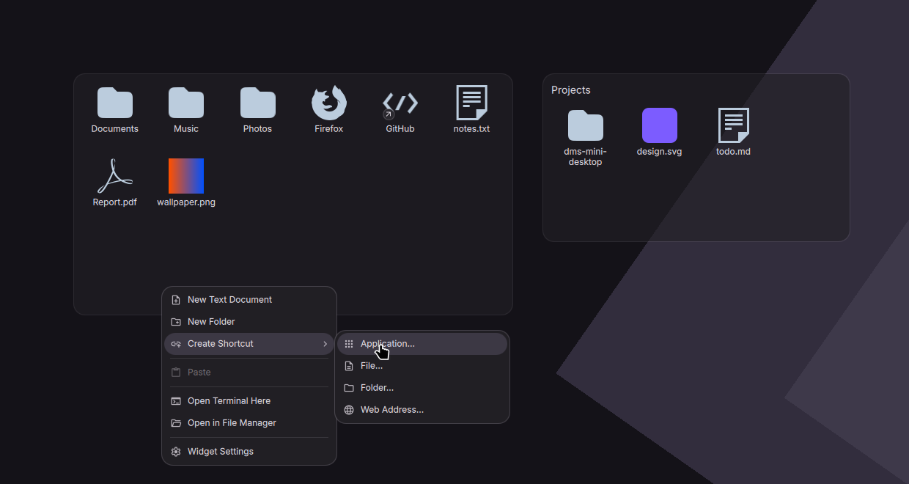

# Mini Desktop

A desktop widget for [DankMaterialShell](https://github.com/AvengeMedia/DankMaterialShell) that gives you a small, classic desktop area: a row of one-click app shortcuts on top, and below it a folder's files as icons, with a context menu that creates documents, folders and shortcuts right there. Everything is written to the folder itself, so your file manager sees the same files.



## Features

- **App shortcuts:** pick apps in the widget settings; their icons sit in a row above the folder's items and open with one click (through DMS's launcher, so your launch prefix applies). Add, remove and reorder them in the settings; a widget can also show only shortcuts or only the folder.
- Shows the Desktop folder (`xdg-user-dir DESKTOP`) by default, or **any folder per widget**: add several widgets, each with its own folder, optionally titled with the folder name.
- **Blank-area menu:** New Text Document, New Folder, New from Template (files in `~/Templates`), Create Shortcut (application, file, folder, web address), Sort By, Paste, Open Terminal Here, Open in File Manager, Widget Settings, Edit Widgets.
- **Item menu:** Open / Launch, Open With (DMS application picker), Cut, Copy, Copy Path, Rename, Move to Trash. Nothing is ever deleted permanently.
- **Launchers are safe:** a `.desktop` launcher runs only when it is executable, as in Nemo and Dolphin. One that is not (a downloaded file, for example) is shown by its file name with a warning badge and runs only after **Allow Launching** from its menu. Shortcuts created by the widget are executable.
- New items are selected and their name opens for editing right away. Renaming a `.desktop` launcher changes its visible name, like Nemo does.
- Copy and cut put files on the Wayland clipboard in the formats GTK, Nemo, Nautilus, Dolphin and KDE apps read; paste accepts files, images, links and text.
- **Sorting:** by name, type, date modified or size (folders first), or **Free Placement**: drag an item to any cell in the widget, empty cells included, and it stays there; other selected items keep their place relative to it, and nothing else moves. New files take the first free cell. Choosing Free Placement again brings back the last layout.
- Drag and drop: from your file manager into the widget or onto a folder icon, between widgets, and out of the widget into other apps.
- Selection with Ctrl/Shift and rubber band; keyboard: Ctrl+A/C/X/V, Delete, F2, Enter, arrows, Esc, Menu / Shift+F10, F5.
- Image previews, and thumbnails for videos and other types through the system thumbnailers.
- The folder is watched, so changes made elsewhere show up immediately.
- Apps start through DMS's own launcher path (`SessionService.launchDesktopEntry`), so your launch prefix and per-app overrides apply.
- English and Turkish UI.

### Opening the menus

Right-click (or middle-click) a blank spot, a shortcut or an item, or press the Menu key. To move or resize the widget, choose **Edit Widgets** from the blank-area menu.

## Settings

Each widget instance has its own settings (**Widget Settings** in its menu, or **Settings → Desktop Widgets**):

- **App shortcuts** — add apps, change their order with the arrows, remove them.
- **Folder** — type a path (`~/Desktop/Games`) or pick one with **Choose…**; empty means the Desktop. If the folder does not exist, the widget offers to create it.
- **Show title** — the folder name above the icons (off by default).
- **Sort by** — name, type, date modified, size or free placement (also in the blank-area menu).
- **Icon size** and **Background opacity** (0 shows only the icons).

## Installation

From the DMS plugin browser: **Settings → Desktop Widgets → Browse Plugins**, search for *Mini Desktop*, then add the widget.

Manually:

```bash
git clone https://github.com/KadirJeager/dms-mini-desktop ~/.config/dms/plugins/miniDesktop
```

Then restart DMS (or run `dms ipc call plugins reload miniDesktop`) and add it with **Settings → Desktop Widgets → Add Widget**.

## Requirements

- DankMaterialShell 2.0.0 or newer
- `python3` with PyGObject (`python-gobject`) and `python-pywayland`
- `wl-clipboard` (reading the clipboard)
- A compositor that offers `ext-data-control-v1` (Hyprland does) for Copy and Cut

Tested on DMS 2.0.0 with Hyprland 0.56.

## How it works

- `MiniDesktop.qml` — the widget: grid, selection, keyboard, drag and drop, menu actions.
- `MiniDesktopItem.qml` — one icon.
- `MiniDesktopOverlay.qml` — a full-screen overlay surface for the menus and the rename field; the widget itself sits on the bottom layer, below windows.
- `helper/minidesktop.py` — file, clipboard and preview backend (`python3 helper/minidesktop.py --help`). It watches the folder with GIO, makes thumbnails with the system `.thumbnailer` entries and owns the clipboard through `ext-data-control-v1` so several formats can be offered at once.

## License

MIT
